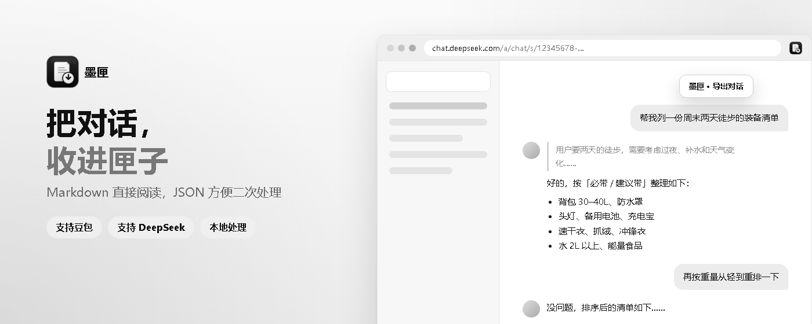
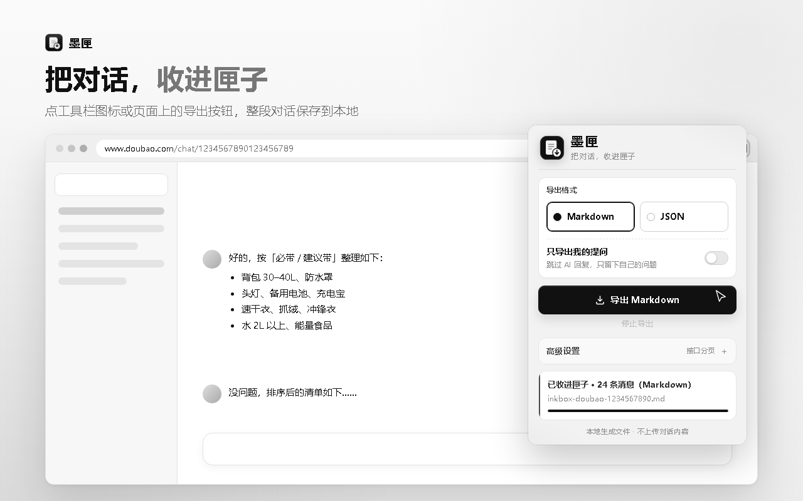
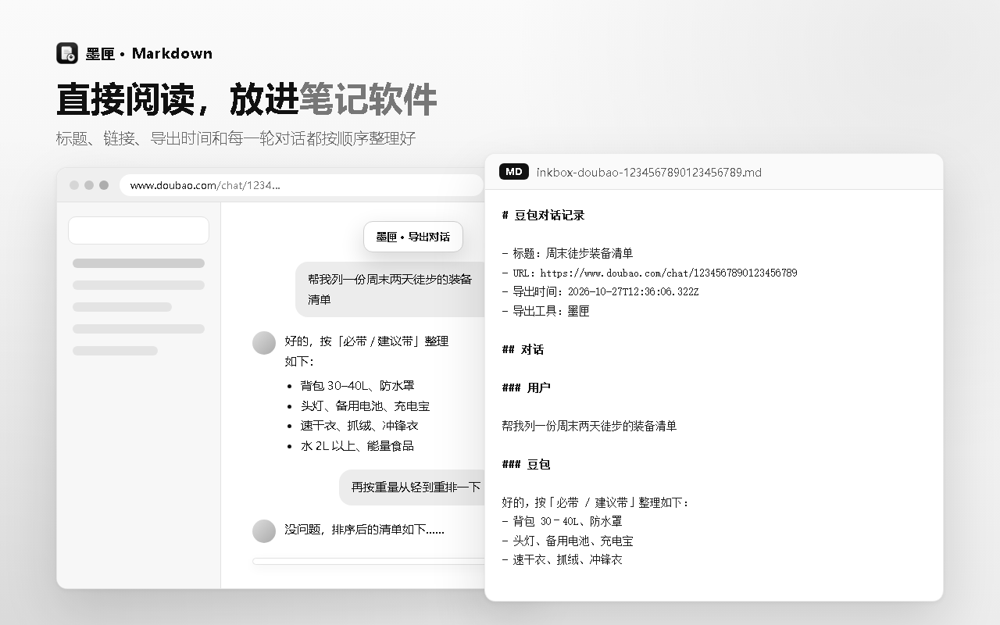
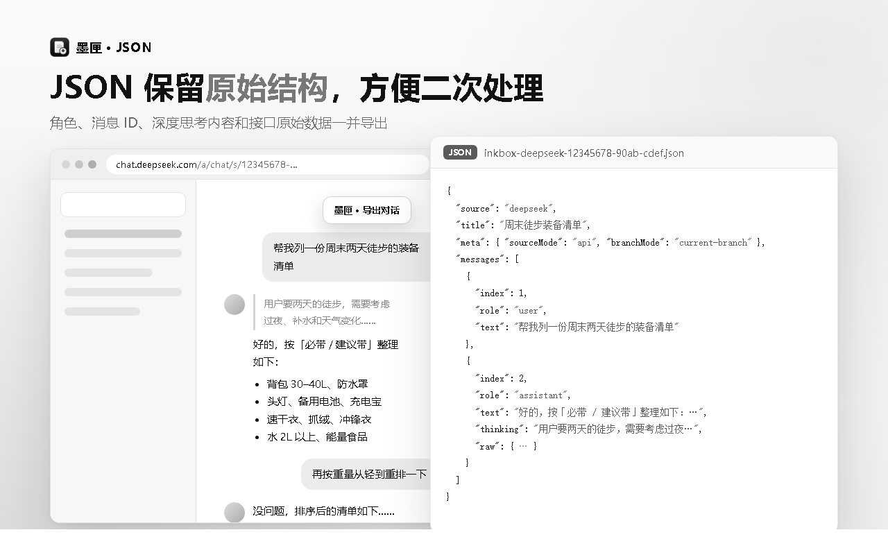
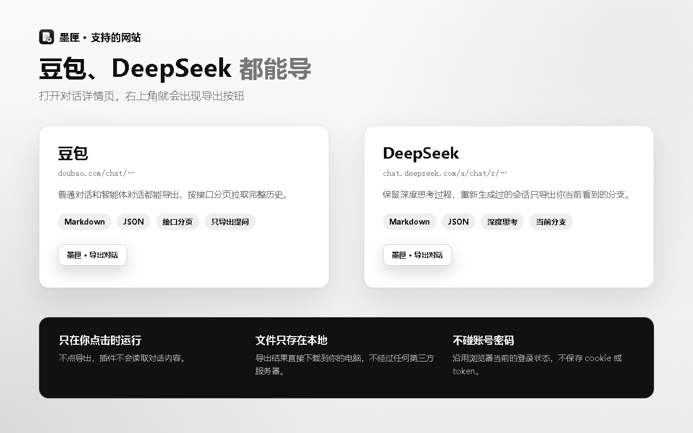
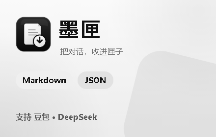

# 墨匣

> 把对话，收进匣子。

墨匣是一个 Chrome 扩展，用来把豆包、DeepSeek 网页版里的当前对话导出为 Markdown 或 JSON。所有文件都在本地生成，不上传对话内容。



## 预览

| 弹窗导出 | Markdown 结果 |
| --- | --- |
|  |  |
| **DeepSeek + JSON 结果** | **支持的网站与隐私** |
|  |  |

商店用小尺寸宣传图：



## 功能

- 支持豆包（`doubao.com`）和 DeepSeek（`chat.deepseek.com`）的对话详情页
- 导出 Markdown：适合阅读、整理、归档到笔记软件
- 导出 JSON：保留角色、消息 ID、原始消息数据，方便二次处理
- 可只导出自己的提问，跳过 AI 回复（默认关闭）
- 对话页右上角提供「墨匣 · 导出对话」悬浮按钮，可拖动、会记住位置
- 工具栏弹窗提供格式单选、只导出提问和接口分页上限
- 豆包支持接口分页，可导出很长的历史对话
- DeepSeek 保留深度思考内容；重新生成过的会话只导出当前分支
- 导出过程中可随时停止

## 安装

需要 Chrome 88 及以上（Manifest V3），Edge 等 Chromium 内核浏览器同样可用。

1. 把本项目下载或克隆到本地文件夹。
2. 打开 Chrome 的 `chrome://extensions/`。
3. 打开右上角「开发者模式」。
4. 点击「加载已解压的扩展程序」，选择本项目根目录。
5. 修改代码后，在扩展卡片上点击刷新，并刷新豆包 / DeepSeek 页面。

## 使用

1. 打开任意豆包或 DeepSeek 的对话详情页，例如：
   - 豆包：`https://www.doubao.com/chat/bot/chat/1234567890123456789`
   - DeepSeek：`https://chat.deepseek.com/a/chat/s/会话ID`
2. 页面右上角会出现白底的「墨匣 · 导出对话」按钮。点击即可按默认设置导出 Markdown。
3. 也可以点击浏览器工具栏里的墨匣图标，在弹窗里选择导出格式后点击导出。
4. 浏览器会把 `.md` / `.json` 文件下载到本地。

悬浮按钮固定使用 Markdown 和默认读取设置；需要 JSON 或调整分页上限时，请使用弹窗。通过弹窗发起的导出可以点击「停止导出」中断。

「只导出我的提问」默认关闭，可以在弹窗里勾选。勾选后，Markdown 和 JSON 都只包含 `role` 为 `user` 的消息。这个设置会保存在浏览器本地，悬浮按钮也会沿用最近一次选择。

## 导出格式

### Markdown

标题、来源链接、导出时间、导出工具和每一轮对话会按顺序整理。DeepSeek 的思考过程以引用块放在回答前面。

文件名格式：

- `inkbox-doubao-对话ID-时间.md`
- `inkbox-deepseek-会话ID-时间.md`

### JSON

在弹窗里选择 JSON 后导出，适合需要二次处理的使用者。JSON 会保留接口返回的 `raw` 原始消息，便于处理图片、搜索卡片、引用、工具调用等复杂内容。

两种格式都会带上 `scope` 字段：`full` 表示完整对话，`user-only` 表示只导出了用户提问。只导出提问时，`meta.collectedCount` 记录过滤前收集到的消息总数。

## 高级设置

弹窗里的高级设置默认折叠，只包含豆包的接口分页参数，普通使用可以忽略。

- 接口页数：豆包接口最多拉取多少页，默认 `1000`。
- 每页条数：每次接口请求拉取多少条原始消息，默认 `20`。
- 起始 Anchor：默认自动。普通 `/chat/数字ID` 会使用 `9007199254740991 + direction=1`，`/chat/bot/chat/数字ID` 会使用 `0 + direction=3`。

接口模式默认最多拉取 `1000 * 20 = 20000` 条原始消息。插件会按当前 URL 类型自动选择首次分页参数，再按返回消息里的 `index_in_conv` 作为下一页锚点，用 `direction=1` 往更早的历史消息翻页。

弹窗导出固定走接口读取，不会滚动页面；接口拿不到内容时会直接提示失败，避免接口数据和滚动数据混在一起造成顺序或重复错乱。

## DeepSeek 实现说明

支持 `https://chat.deepseek.com/a/chat/s/会话ID`（以及不带 `/a` 的 `/chat/s/会话ID`）这类会话详情页。

1. **接口（默认）**：`deepseek-page-hook.js` 注入页面，hook `fetch` / `XHR`，记录页面自身调用 `/api/v0/...` 时的请求头，并缓存 `/api/v0/chat/history_messages` 的返回。导出时由页面脚本用同样的请求头重新请求历史消息；如果没观察到请求头，则读取页面 `localStorage.userToken` 拼 `Bearer` 头。请求失败时用缓存兜底。
2. **当前分支**：DeepSeek 的消息是树状结构（重新生成、编辑提问会产生分支）。插件沿 `chat_session.current_message_id` 顺着 `parent_id` 往上，只导出当前看到的那条分支；拿不到该字段时按 `message_id` 排序导出全部消息，`meta.branchMode` 会标明使用的模式。
3. **DOM 兜底**：悬浮按钮使用「接口优先」，接口失败时读取当前页面 DOM，不滚动；弹窗导出固定走接口。DOM 识别依赖 `.ds-markdown`、`.ds-think-content`、`.ds-message` 等相对稳定的 class。

弹窗里的「接口页数 / 每页条数 / 起始 Anchor」只对豆包生效。

DeepSeek 的接口路径、鉴权方式和 DOM 选择器按当前网页结构编写；如果 DeepSeek 改版，可能需要相应调整 `deepseek-content.js`。

## 项目结构

| 路径 | 说明 |
| --- | --- |
| `manifest.json` | 扩展清单，声明站点内容脚本和权限 |
| `content.js` / `page-hook.js` | 豆包导出：悬浮按钮、接口分页、DOM 兜底 |
| `deepseek-content.js` / `deepseek-page-hook.js` | DeepSeek 导出，与豆包逻辑独立 |
| `popup.html` / `popup.js` / `popup.css` | 工具栏弹窗与导出选项 |
| `icons/` | 扩展图标（16 / 32 / 48 / 128） |
| `store-assets/` | 商店截图、宣传图、上架文案和隐私政策 |
| `store-assets/design/` | 图标、商店图的 HTML 设计稿与渲染脚本 |

## 重新生成图标和商店素材

安装 Python 3 和 Pillow，并确保本机有 Chrome 或 Edge：

```bash
python store-assets/design/render.py
```

脚本会重新生成 `icons/` 下的图标和 `store-assets/` 下的商店截图与宣传图。也可以用环境变量 `CHROME` 指定浏览器路径。

## 隐私

- 只有用户主动点击导出时，扩展才会读取对话内容。
- 悬浮按钮只在豆包、DeepSeek 的对话详情页出现。
- 不读取或保存账号密码，不内置、保存或展示 cookie 明文。
- 不把对话内容上传到开发者服务器。
- 豆包接口请求只发送到当前页面所属的 `doubao.com`，使用浏览器当前登录态。
- DeepSeek 接口请求只发送到 `chat.deepseek.com`，由页面脚本带上页面自身的登录 token；token 只在页面内使用，不会传给扩展的其它部分，也不会保存。
- 导出的 Markdown / JSON 文件保存在用户本地下载目录。

## 边界

- 只能导出当前账号可见、当前页面能加载出来的内容。
- 豆包接口分页依赖 `/im/chain/single` 返回结构，主要使用 `has_more`、`index_in_conv` 和 `content_block`；接口变化时导出会提示失败，不会自动混入页面滚动数据。
- 豆包前端 class 名可能变化，插件里做了多层兜底，但页面大改版后仍可能需要调整 `content.js`。

## 免责声明

墨匣不是豆包、字节跳动或 DeepSeek 的官方产品，也未与它们建立官方合作、授权或背书关系。请只导出你自己有权访问和保存的内容。
