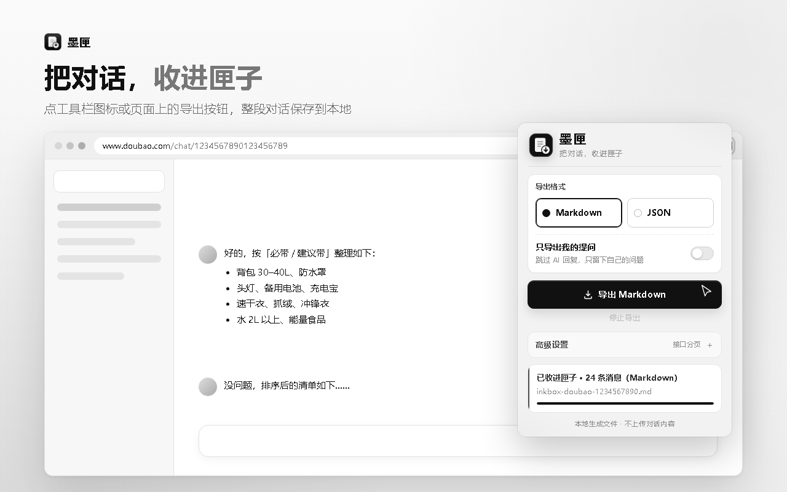

# 墨匣 · 对话导出

> 把对话，收进匣子。

墨匣是一个 Chrome 浏览器扩展，用来把**豆包**和 **DeepSeek** 网页版里的当前对话导出为 Markdown 或 JSON。它读取的是你当前账号、当前页面能看到的对话，文件在本地直接生成，**不上传对话内容**。

和复制粘贴相比，墨匣保留完整的对话结构：角色区分、消息顺序、DeepSeek 的思考过程、原始消息数据，一次导出即可归档。



## 为什么需要它

- **网页对话会散**：重要讨论、方案、代码片段留在聊天窗口里，时间一长就找不到了。
- **复制粘贴会乱**：Markdown 渲染后的内容复制出来常常丢失格式、代码块和引用关系。
- **长对话翻不完**：豆包的历史消息需要分页拉取，手动滚动既慢又容易漏。

墨匣直接调用页面自身使用的接口读取完整会话，按顺序整理后生成本地文件，适合归档、整理和二次处理。

## 核心功能

| 功能 | 说明 |
| --- | --- |
| 双平台支持 | 豆包 `doubao.com`、DeepSeek `chat.deepseek.com` 的对话详情页 |
| 两种格式 | Markdown 适合阅读归档，JSON 保留原始消息数据便于二次处理 |
| 只导出提问 | 可跳过 AI 回复，只留下自己的问题，默认关闭 |
| 悬浮按钮 | 对话页右上角的「墨匣 · 导出对话」，可拖动，会记住位置 |
| 长对话分页 | 豆包支持接口分页，默认最多拉取 20000 条原始消息 |
| 分支处理 | DeepSeek 重新生成、编辑提问产生的分支，只导出当前看到的那一条 |
| 深度思考 | DeepSeek 的思考过程以引用块完整保留 |
| 随时停止 | 弹窗发起的导出可点击「停止导出」中断 |

## 导出效果

Markdown 文件会按顺序组织标题、来源链接、导出时间、导出工具和每一轮对话：

```markdown
# 关于浏览器扩展通信机制的讨论

- 来源：https://chat.deepseek.com/a/chat/s/xxxxxxxx
- 导出时间：2026-11-12 15:30:00
- 导出工具：墨匣

## 我

Chrome 扩展里 content script 和 page script 怎么通信？

## DeepSeek
...
```

文件名带有平台、会话 ID 和时间：

- `inkbox-doubao-对话ID-时间.md`
- `inkbox-deepseek-会话ID-时间.md`

## 安装

需要 Chrome 88 及以上（Manifest V3），Edge 等 Chromium 内核浏览器同样可用。

1. 下载或克隆本项目到本地文件夹。
2. 打开 `chrome://extensions/`，开启右上角「开发者模式」。
3. 点击「加载已解压的扩展程序」，选择项目根目录。
4. 打开任意豆包或 DeepSeek 的对话详情页即可使用。

## 使用

1. 进入一个对话详情页。
2. 点击页面右上角的「墨匣 · 导出对话」，按默认设置导出 Markdown。
3. 或点击浏览器工具栏的墨匣图标，在弹窗里选择导出格式、勾选「只导出我的提问」，再点击导出。
4. 文件会保存到浏览器的下载目录。

悬浮按钮固定使用 Markdown；需要 JSON 或调整豆包的接口分页参数时，请使用弹窗。分页设置位于弹窗的「高级设置」中，默认折叠，普通使用无需关心。

## 隐私

- 只有你主动点击导出时，扩展才会读取对话内容。
- 悬浮按钮只在豆包、DeepSeek 的对话详情页出现。
- 不读取或保存账号密码，不内置、保存或展示 cookie 明文。
- 对话内容不经过开发者服务器，全部在本地生成文件。
- 接口请求只发往当前页面所属的域名，使用浏览器当前的登录态。

## 技术实现

- 清单使用 Manifest V3，内容脚本按站点独立注入。
- `content.js` / `page-hook.js`：豆包导出，接口分页优先，DOM 兜底。
- `deepseek-content.js` / `deepseek-page-hook.js`：DeepSeek 导出，页面脚本复用页面自身的请求头读取历史消息，并按 `parent_id` 还原当前分支。
- `popup.html` / `popup.js` / `popup.css`：工具栏弹窗与导出选项。

更完整的实现说明、接口参数和边界情况见 [README.md](README.md)。

## 已知边界

- 只能导出当前账号可见、当前页面能加载出来的内容。
- 导出依赖平台接口和页面结构，平台改版后可能需要更新扩展。
- 墨匣不是豆包、字节跳动或 DeepSeek 的官方产品，请只导出你自己有权访问和保存的内容。

## 交流与反馈

QQ 交流群：**225364948**

使用问题、导出异常或功能建议，欢迎进群反馈。
